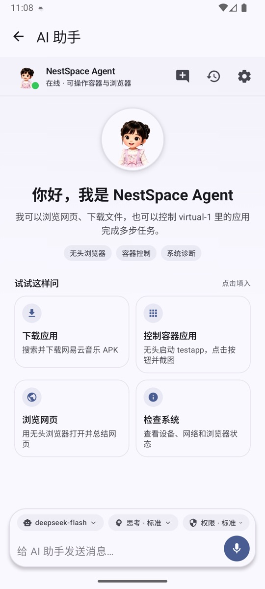
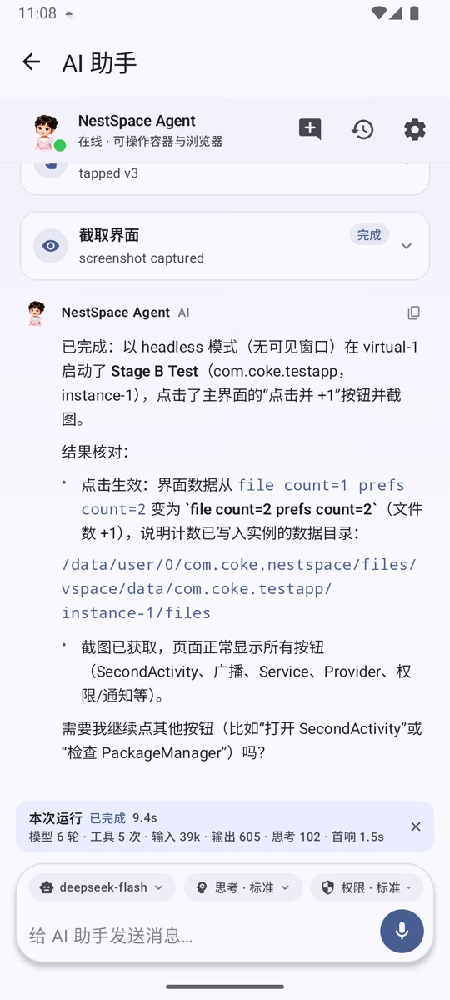

# AI assistant

The AI assistant can observe virtual apps in NestSpace, tap the interface, enter text, take screenshots, and operate the built-in browser. It always works inside "virtual space 1" and does not control other apps in the system.

## Opening the assistant

- **AI assistant** on the desktop.
- The Floating dot at the bottom of the screen (once enabled).
- Voice assistant: Tap the circle on the Floating dot.

The desktop assistant and the voice assistant share the same conversation history, so you can keep asking follow-up questions.

## Two operating modes

### Rule mode (default)

When no model is configured, the built-in rule-based Agent is used. It can perform simple fixed commands, such as:

- Observe the current interface;
- Open settings;
- Tap a piece of text;
- Back, home, screenshot.

Rule mode does not access the network and is useful for quickly verifying that container control works correctly.

### Large model mode

After configuring an endpoint in **Space settings → Model settings**, the assistant uses a large model to plan steps and call tools. Supports:

- **Claude-compatible**: `POST /v1/messages`, using native `tools` / `tool_use` / `tool_result`.
- **OpenAI-compatible**: `POST /v1/chat/completions`, using native `tool_calls` / `tool` messages.

## Configuring a model

Entry point: **Space settings → Model settings**.

You can save multiple configurations and switch between them at any time. Each configuration contains:

| Field | Description |
| --- | --- |
| Protocol | Claude-compatible / OpenAI-compatible |
| Base URL | Endpoint address, for example `https://api.anthropic.com` |
| API Key | Write-only field, encrypted with the Android Keystore |
| Model | Model name required by the endpoint |
| Context size | Context token limit; default 800000, minimum 100000 |
| Max tool rounds | Maximum number of tool calls per conversation turn; default 128 |

After saving, tap **Test connection** to send a real request and confirm that the address, Key, and model are usable.

The system prompt is a global setting, available under **Space settings → System prompt**, and is shared by all models. At runtime, the current time, memories, skill index, and tool rules are also appended automatically.

## Chat interface

- The message stream shows user messages, assistant messages, and errors.
- Replies use streaming output, with text displayed as it is generated; a spinner is shown while waiting for the first content.
- Tool calls are displayed as expandable cards with their running status in real time, and you can view parameters and results.
- Replies support basic Markdown, code blocks, copying, and text selection.
- You can start a new conversation and return to the welcome page and quick task cards.
- Conversation history keeps recent message turns, and every model request includes the context.

## Thinking level

You can switch the thinking level in the chat interface; it is saved separately for each model:

| Level | Behavior |
| --- | --- |
| Quick | Execute directly and give the result, avoiding lengthy reasoning |
| Light | Make a brief assessment first, then call the necessary tools |
| Standard | Briefly analyze before acting, and verify results after tool calls |
| Deep | Break down the task and compare options first, and verify results after every tool call before continuing |

For supported models, native parameters are also sent: Claude uses `thinking.budget_tokens`, while the o series / GPT-5 / Codex use `reasoning_effort`. Other compatible endpoints use prompt constraints only, avoiding request failures caused by unsupported parameters.

## Tool scope

The assistant can use:

- `space_*`: List, install, launch, duplicate, uninstall, stop, and manage permissions;
- `ui_*`: Observe the view tree, tap, input, wait, take screenshots, and go back;
- `browser_*`: Open tabs, read pages, click, download, upload, and hand to user;
- `spawn_agent`: Hand read-only subtasks to a child Agent;
- `schedule_task`: Create scheduled tasks.

Remote MCP settings tools and assistant bridge tools are not exposed to the assistant itself, avoiding recursive calls and prompt injection.

## Permission confirmation

**Space settings → Permissions** controls whether sensitive actions require confirmation:

- **Strict**: Installation/uninstallation, permission changes, risky taps, downloads, and more all require confirmation; reusable procedures also show a confirmation card first.
- **Standard**: Adds installation/uninstallation confirmation on top of Loose; memories and automatically drafted skills are saved directly (skills are disabled by default).
- **Loose**: Only money-related actions such as payments, checkout, transfers, and red packets prompt for confirmation; memories and automatically drafted skills are saved directly (skills are disabled by default).
- **Custom**: You choose the categories that require confirmation; when **Risky taps** confirmation is enabled, reusable procedures show a confirmation card first.

## Memory & skills

### Memories

After each conversation turn, the assistant automatically organizes key facts, user preferences, and reusable procedures. When confirmation is needed, a confirm/ignore card is shown in the conversation stream; you can also view, approve, pin, or delete entries at any time in **Space settings → Memory & skills**.

- Facts and preferences always take effect directly; reusable procedures take effect directly under Standard/Loose permissions.
- In Strict mode, or in Custom mode with **Risky taps** confirmation enabled, procedures show a confirmation card first.
- Passwords, verification codes, bank card details, and ID card information are not recorded automatically.
- Memories are stored in the app-private directory and encrypted; when used, relevant entries are sent to the current model service as part of the system prompt.

### Skills

There are 7 built-in skill packs covering information research, messages and email, content organization, downloads and uploads, settings guidance, scheduled tasks, and skill writing. The assistant reads them by index rather than putting all of them into the prompt.

- After successfully completing a task with at least 4 tool steps, the assistant automatically drafts a skill; new skills are disabled by default and an enable card is shown in the conversation.
- Each use records success or failure; 2 failures in the most recent 3 uses disable a skill automatically, and the count restarts after you re-enable it manually.
- Custom skills can be edited, support importing `SKILL.md`, and support version history and restoring older versions. Built-in skills can only be disabled; they cannot be deleted or overwritten.

## Scheduled tasks

Ask the assistant to create scheduled tasks, for example:

> Check the weather every morning at 9 and tell me only if it will rain.

One-time, daily, weekly, and fixed-interval schedules are supported. When a task is due, it runs in the original conversation and sends a result notification. You can view and delete tasks in **Space settings → Scheduled tasks**.

## Voice assistant

### Enabling the Floating dot

**Space settings → Floating dot** → turn on **Show floating dot** and grant the "Display over other apps" permission.

- The Floating dot can be dragged and automatically snaps to the edge.
- You can set separate colors for the host UI and for containers.
- You can adjust opacity and position.
- By default, the desktop and containers use the container color (blue), while the host UI uses the host color (orange).

### Using it

1. Tap the circle on the Floating dot to open the full-screen voice assistant.
2. Tap the microphone or the circle to start/stop listening.
3. Interim recognition results are shown in real time, and the final result is sent automatically.
4. When the reply is finished, listening starts again automatically, so you can continue with follow-up questions.

The text input box is hidden by default; tap the keyboard icon in the lower-left corner to switch to text input.

### Offline speech models

- Uses Vosk for local recognition; audio never leaves the device.
- On first use, a model of about 40 MB is downloaded on demand.
- Multiple sources are provided: the HF China mirror, Hugging Face, and Vosk official; download speed is tested automatically and the fastest route is chosen, with automatic switching if a download is interrupted.
- After download, the model is loaded in the background and preloaded automatically on the next start.
- Supports two small models: Chinese and English.

## Child Agents

`spawn_agent` can hand a self-contained subtask to a read-only child Agent:

- 15 steps by default, up to 40 steps;
- It can only observe containers and browse web pages; it cannot tap, input, launch apps, install apps, or create further child tasks;
- Results are kept to 4000 characters by default, up to 8000 characters;
- Results are returned to the main Agent as untrusted data.

View and stop runs in **Space settings → Child runs**.

## Common issues

### Test connection fails

- Check whether the Base URL includes the correct path (Claude defaults to `https://api.anthropic.com`, OpenAI defaults to `https://api.openai.com`).
- Check whether the API Key is valid and has a remaining balance.
- Check whether the model name matches the one provided by the endpoint.
- Some compatible endpoints do not support native `thinking` or `reasoning_effort`; use prompt constraints instead or switch models.

### The assistant does not call tools

- Confirm that a model has been configured and the connection test passes.
- Confirm that the target app is installed in "virtual space 1" and has been launched.
- Increase **Max tool rounds** or reduce task complexity.
- Check the tool cards in the conversation to see whether the tools report errors.

### Voice recognition does not respond

- Confirm that recording permission has been granted.
- Confirm that the offline speech model has finished downloading.
- Switch the speech model once in **Space settings → Floating dot**.

### Scheduled tasks do not run

- Confirm that the task is enabled.
- Check whether the system restricts NestSpace's background activity or exact alarm permission.
- Some systems delay alarms in power-saving mode; allow background activity and try again.

## Related documentation

- [Settings](settings.md)
- [Built-in browser](browser.md)
- [MCP tool reference](mcp-tools.md)
