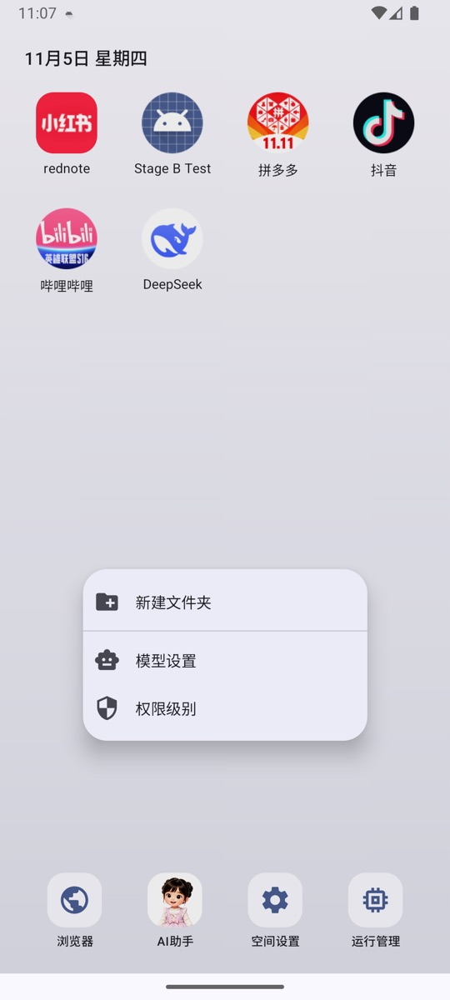
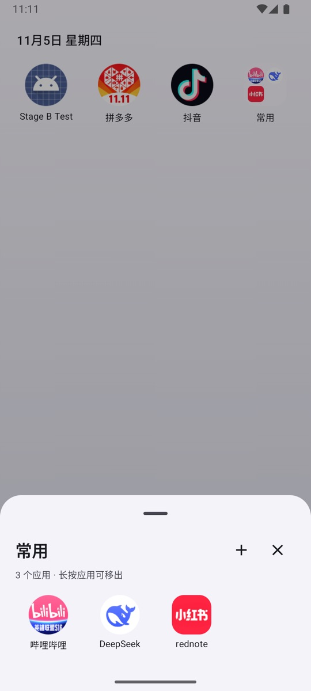

# Desktop & appearance

The NestSpace desktop is not the system launcher; it is a launcher inside the app. It shows fixed entry points, virtual apps, and shortcuts to the system apps you select.

## What is on the desktop

Default entry points:

| Entry | Purpose |
| --- | --- |
| Space settings | All configuration, including App management, models, the Floating dot, and MCP |
| AI assistant | Opens the local AI assistant |
| Browser | Opens the built-in multi-tab browser |
| Running apps | View and stop running container processes |

The following also appear:

- Virtual apps installed through **App management → Import APK**.
- System apps selected through **App management → Import desktop apps**.
- Folders you create yourself.

## Icon actions

### Tap

- Virtual app: Launches the most recently used instance.
- System app: Opens the original system app.
- Folder: Opens the folder.

### Long-press an app

Long-pressing an app icon opens a menu:

- **App shortcuts**: Dynamic shortcuts provided by the app itself (if any) appear at the top of the menu.
- **Open**: Launches the app.
- **Add to folder**: Shown when folders already exist on the desktop; choose which folder to add the app to.
- **Move to front / Move to back**: Adjusts the order.
- **App info**: View the app's package name, version, and instance information.
- **Uninstall**: Deletes the virtual app and all instance data (virtual apps only).
- **Remove from desktop**: Hides the app from the desktop only and does not delete it (system apps only).

### Long-press an empty area

Long-pressing an empty area of the desktop opens a quick menu:

- **New folder**;
- **Model settings**;
- **Permissions**.

### Drag

- Long-press and drag an icon: Reposition it, with other icons previewing their new positions.
- Drag onto another app with an overlap smaller than 30%: A folder ghost appears over the target icon, and releasing creates a folder.
- If the overlap reaches 30% or more (including complete coverage), the behavior changes to insertion/shifting.
- Drag onto an existing folder: Adds the app to that folder.
- Icons inside a folder cannot be reordered by dragging directly. After opening a folder, long-press an app and choose **Remove from folder**, or drag it upward to remove it.

The desktop layout is saved automatically and persists after a restart.

## Folders

A folder is a container on the desktop. You can:

- Open it and view the apps inside;
- Tap the **+** to the right of the title to add apps;
- Long-press a folder to rename or dissolve it;
- After opening it, long-press an app to open or remove it, or drag it upward to remove it.

A folder with only one app left dissolves automatically. An empty folder created from an empty area is kept. After you add the first app, it is also kept temporarily so you can continue adding more.

A folder stores only the desktop layout; it does not move or copy app data.

## Wallpaper

Entry point: **Space settings → Desktop wallpaper**.

- You can choose an image as the desktop wallpaper.
- You can clear the wallpaper and restore the default background.
- The wallpaper is stored in the app-private directory and is deleted when NestSpace is uninstalled.

## System app shortcuts

Entry point: **Space settings → App management → Import desktop apps**.

- Selected apps appear on the desktop, and tapping one runs the original app installed in the system.
- Clearing a selection removes the app from the desktop without affecting the app itself.
- NestSpace does not copy system apps or modify their data.

## Running apps

Entry point: **Running apps** on the desktop.

The page shows:

- The number of container processes currently running.
- The total memory used by those processes.
- A process list grouped by app and instance.

Expanding a group lets you:

- View the slot, process name, and memory usage of each container process.
- Tap the close button on the right to end a single process; app data is preserved.
- Tap the close button to the right of the group to end all container processes for that app.

An app that was ended recreates its processes and loads its original data the next time it starts.

## Desktop display issues

- **Icons are missing**: Check whether the app is still present in **Space settings → App management**. The desktop layout is stored inside the app; clearing NestSpace data resets the layout.
- **The order is wrong**: Long-press and drag to rearrange the icons; the layout is saved automatically.
- **A system app does not appear**: Check its selection state under **Import desktop apps**, and make sure the app is still installed in the system.
- **The wallpaper is not displayed**: Open **Space settings → Desktop wallpaper** and set it again; if the image has been deleted, choose a new one.

## Related documentation

- [App installation & management](app-manager.md)
- [Settings](settings.md)
