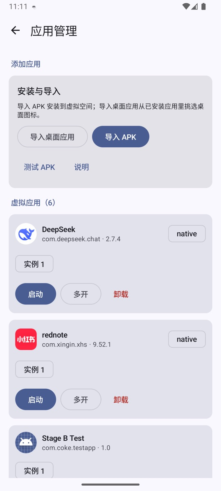

# 應用程式安裝與管理

入口：**「空间设置」（空間設定）→「应用管理」（應用程式管理）**。



這個頁面分為三塊：

1. **安裝與匯入**：匯入 APK、匯入桌面應用程式、測試 APK。
2. **虛擬應用程式**：已經安裝到 NestSpace 內部的應用程式。
3. **桌面應用程式**：目前放在桌面上的系統應用程式。

## 匯入 APK

1. 點「导入 APK」（匯入 APK）。
2. 在系統檔案選擇器裡選擇 APK。
3. 等待解析和安裝完成。

一般應用程式選一個 APK 即可。split 應用程式需要一次選取所有檔案：

```text
base.apk
split_config.arm64_v8a.apk
split_config.xxhdpi.apk
...
```

只選 base 會缺少程式碼、原生程式庫或資源，應用程式可能在啟動時失敗。

匯入過程中會做以下檢查：

| 檢查 | 失敗時的行為 |
| --- | --- |
| 套件名稱 | 拒絕安裝 |
| 簽章一致性 | 同一個套件名稱已有記錄但簽章不同，傳回 `SIGNATURE_MISMATCH` |
| `minSdk` | 高於目前系統版本時拒絕安裝 |
| `REQUIRE_SECURE_ENV` | 目標宣告了安全環境要求時傳回 `SECURE_ENV_REQUIRED` |
| ABI | 安裝會成功，啟動時若沒有符合的原生程式庫會傳回 `ABI_MISMATCH` |

安裝成功後：

- APK 會複製到 NestSpace 的應用程式私有目錄，不依賴原始檔案。
- 應用程式會出現在桌面和「虛擬應用程式」清單。
- 安裝記錄會持久化，重新啟動應用程式後仍然存在。

## 虛擬應用程式清單

每個應用程式一列，包含：

- 應用程式圖示、名稱、套件名稱和版本。
- 執行個體選擇器（「实例 1」（執行個體 1）、「实例 2」（執行個體 2）…）。
- 「启动」（啟動）：開啟目前選取的執行個體。
- 「多开」（多開）：建立一個新執行個體並啟動。
- 「卸载」（卸載）：刪除 APK 和所有執行個體資料。

第一次啟動某個應用程式時會自動建立「執行個體 1」。之後點「多開」會依次建立執行個體 2、3……

### 執行個體與資料隔離

每個執行個體擁有獨立的：

- `files`
- `cache`
- `code_cache`
- `databases`
- `getDir`
- SharedPreferences 命名空間
- native 程式庫擷取目錄

因此同一個應用程式可以同時登入兩個帳號，兩個執行個體之間不會讀到對方的資料。不同應用程式的執行個體之間也是隔離的。

資料目錄結構：

```text
/data/user/0/com.coke.nestspace/files/vspace/
  apps/<package>/...         安裝的 APK
  data/<package>/<instance>/ 執行個體資料
```

### 同時執行數量

容器處理程序池預設自動管理，最多 16 個槽位。記憶體緊張時會關閉最久未使用的背景容器，前景容器不會被關閉。也可以在「空間設定」→「容器槽位」裡設定固定上限（1–16）。

## 匯入桌面應用程式

「导入桌面应用」（匯入桌面應用程式）只影響桌面顯示，不會複製或安裝應用程式：

1. 點「匯入桌面應用程式」。
2. 勾選需要的已安裝應用程式。
3. 取消勾選即可從桌面移除。

虛擬應用程式不需要勾選，安裝後會自動顯示。

## 測試 APK

「测试 APK」（測試 APK）是給開發者驗證容器能力用的捷徑入口。它不會開啟檔案選擇器，而是讀取外部檔案目錄裡的固定檔案：

```text
/sdcard/Android/data/com.coke.nestspace/files/stage-b-test.apk
```

把倉庫建置出的 `testapp-debug.apk` 推送到這個路徑後再點「測試 APK」即可。一般使用者可以直接用「匯入 APK」選擇任意 APK，不依賴這個入口。

testapp 包含多 Activity 跳轉、Service、Provider、廣播、Job、PackageManager 和執行個體隔離測試頁面，適合用來確認容器功能是否正常。

## 卸載

卸載虛擬應用程式會刪除：

- 已安裝的 APK；
- 全部執行個體；
- 全部執行個體資料、快取和資料庫；
- 該應用程式在 NestSpace 命名空間下的 SharedPreferences。

此操作無法復原。系統應用程式可以用桌面長按選單裡的「从桌面移除」（從桌面移除）隱藏，不會刪除資料；虛擬應用程式目前沒有個別的隱藏入口。

## 常見安裝問題

### `SIGNATURE_MISMATCH`

同一個套件名稱之前安裝過不同簽章的 APK。先卸載舊應用程式再安裝，或者使用相同簽章重新打包。

### `SECURE_ENV_REQUIRED`

目標應用程式在 manifest 裡宣告了 `REQUIRE_SECURE_ENV`。NestSpace 不是它要求的安全環境，目前會拒絕安裝。

### `ABI_MISMATCH`

APK 只包含 arm64 或 armeabi-v7a 的原生程式庫，目前裝置架構不相符。換用對應架構的實機，或使用帶有對應 ABI 的安裝包。

### 啟動後黑屏或閃退

通常是應用程式相容性問題，例如加固、native SDK、動態載入或相依性衝突。可以先執行「空間設定」→「容器自检」（容器自我檢查），再向專案提交 issue，附上應用程式版本和錯誤資訊。

### 安裝成功但桌面沒有圖示

進入「空間設定」→「應用程式管理」確認應用程式是否在「虛擬應用程式」清單裡，並直接在那裡啟動。系統應用程式需要先在「匯入桌面應用程式」裡勾選。

## 相關文件

- [容器槽位與權限](settings.md)
- [架構與限制](architecture.md)
- [常見問題](troubleshooting.md)
