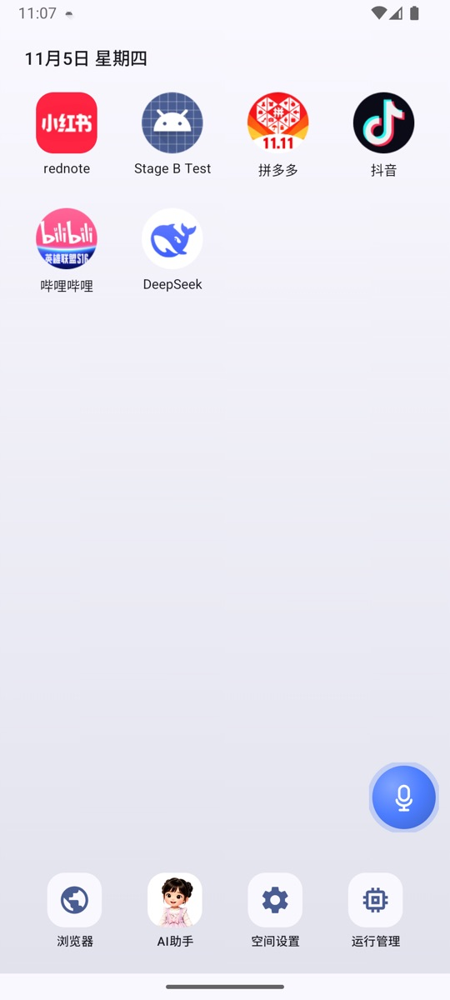
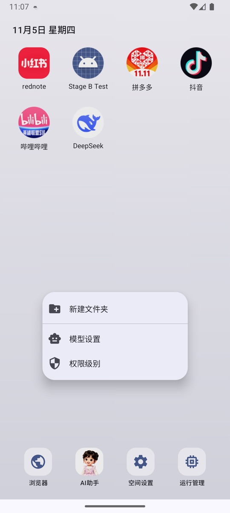

# 桌面與外觀

NestSpace 的桌面不是系統桌面，而是應用程式內的啟動器。它會顯示固定入口、虛擬應用程式，以及你勾選的系統應用程式捷徑。

## 桌面上的內容

預設入口：

| 入口 | 用途 |
| --- | --- |
| 「空间设置」（空間設定） | 應用程式管理、模型、懸浮球、MCP 等所有設定 |
| 「AI助手」（AI 助手） | 開啟本機 AI 助手 |
| 「浏览器」（瀏覽器） | 開啟內建多分頁瀏覽器 |
| 「运行管理」（執行管理） | 檢視和結束正在執行的容器處理程序 |

之後會出現：

- 透過「应用管理」（應用程式管理）→「导入 APK」（匯入 APK）安裝的虛擬應用程式。
- 透過「應用程式管理」→「导入桌面应用」（匯入桌面應用程式）勾選的系統應用程式。
- 你自己建立的資料夾。

## 圖示操作

### 點擊

- 虛擬應用程式：啟動最近使用的執行個體。
- 系統應用程式：開啟原本的系統應用程式。
- 資料夾：開啟資料夾。

### 長按應用程式

長按應用程式圖示會開啟選單：

- **「应用快捷方式」（應用程式捷徑）**：應用程式自己提供的動態捷徑（如果有）顯示在選單頂端。
- **「打开」（開啟）**：啟動應用程式。
- **「添加到文件夹」（加入資料夾）**：桌面已有資料夾時顯示，選擇要加入的資料夾。
- **「移到最前 / 移到最后」（移到最前 / 移到最後）**：調整排序。
- **「应用信息」（應用程式資訊）**：檢視應用程式的套件名稱、版本和執行個體資訊。
- **「卸载应用」（卸載應用程式）**：刪除虛擬應用程式和所有執行個體資料（僅限虛擬應用程式）。
- **「从桌面移除」（從桌面移除）**：只從桌面隱藏，不刪除應用程式（僅限系統應用程式）。

### 長按空白處

長按桌面空白區域會開啟捷徑選單：

- **「新建文件夹」（新增資料夾）**；
- **「模型设置」（模型設定）**；
- **「权限级别」（權限等級）**。

### 拖曳

- 長按並拖曳圖示：調整位置，其他圖示會預覽讓位。
- 拖到另一個應用程式上，重疊面積小於 30%：目標圖示上會顯示資料夾虛影，放開後建立資料夾。
- 繼續重疊到 30% 及以上（包括完全覆蓋）：改為插入/位移。
- 拖到已有資料夾上：加入該資料夾。
- 資料夾內不能直接拖曳排序；開啟資料夾後，可以長按應用程式選擇「移出文件夹」（移出資料夾），也可以向上拖曳移出。

桌面版面配置會自動儲存，重新啟動後保持。

## 資料夾

資料夾是桌面上的一個容器，可以：

- 開啟並檢視裡面的應用程式；
- 點標題右側的 **+** 新增應用程式；
- 長按資料夾選擇重新命名或解散；
- 開啟後長按應用程式選擇開啟或移出，也可以向上拖曳移出。

只剩一個應用程式的資料夾會自動解散；從空白處新建的空資料夾會保留，新增第一個應用程式後也會暫時保留，方便繼續新增。

資料夾裡儲存的是桌面版面配置，不會移動或複製應用程式資料。

## 壁紙

入口：**「空間設定」→「桌面壁纸」（桌面壁紙）**。

- 可以選擇一張圖片作為桌面壁紙。
- 可以清除壁紙，恢復預設背景。
- 壁紙儲存在應用程式私有目錄，卸載 NestSpace 時一併刪除。

## 系統應用程式捷徑

入口：**「空間設定」→「應用程式管理」→「匯入桌面應用程式」**。

- 勾選的應用程式會出現在桌面，點開後執行的是系統裡原本的應用程式。
- 取消勾選會從桌面移除，不影響應用程式本身。
- NestSpace 不會複製系統應用程式，也不會修改它的資料。

## 執行管理

入口：桌面「執行管理」。

頁面顯示：

- 目前正在執行的容器處理程序數量。
- 這些處理程序合計佔用的記憶體。
- 依應用程式和執行個體分組的處理程序清單。

展開某一組可以：

- 檢視每個容器處理程序的槽位、處理程序名稱和記憶體佔用。
- 點右側的關閉按鈕結束單一處理程序；應用程式資料會保留。
- 點組右側的關閉按鈕結束該應用程式的全部容器處理程序。

被結束的應用程式下次啟動時會重新建立處理程序並載入原本的資料。

## 桌面顯示異常

- **圖示消失**：檢查「空間設定」→「應用程式管理」裡應用程式是否還在；桌面版面配置儲存在應用程式內，清除 NestSpace 資料會重設版面配置。
- **排序混亂**：重新長按拖曳即可，版面配置會自動儲存。
- **系統應用程式沒有出現**：確認「匯入桌面應用程式」裡的勾選狀態，並確認該應用程式在系統中仍然安裝。
- **壁紙不顯示**：重新進入「空間設定」→「桌面壁紙」設定一次；如果圖片已被刪除，重新選擇一張。

## 相關文件

- [應用程式安裝與管理](app-manager.md)
- [設定詳解](settings.md)
