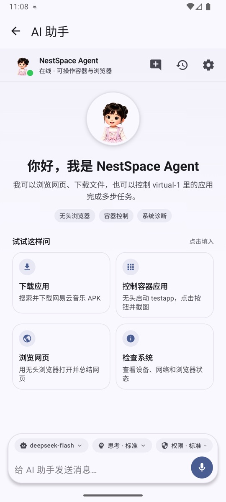
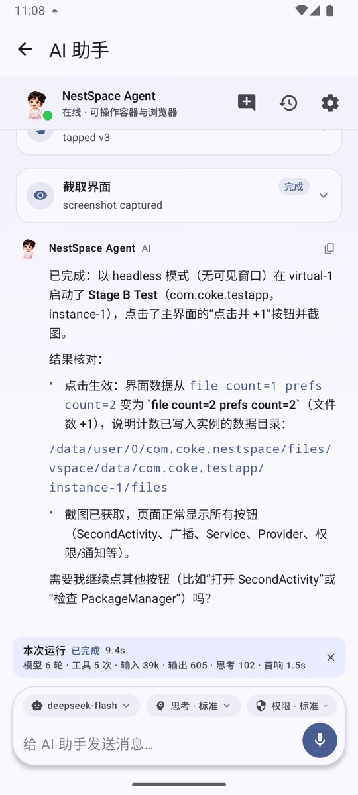

# AI 助手

AI 助手可以观察 NestSpace 里的虚拟应用、点击界面、输入文字、截图和操作内置浏览器。它固定在「虚拟空间 1」中工作，不会控制系统里的其他应用。

## 打开助手

- 桌面「AI助手」。
- 底部悬浮球（开启后）。
- 语音助手：点悬浮球圆点。

桌面助手和语音助手共享同一份对话历史，可以连续追问。

## 两种运行模式

### 规则模式（默认）

没有配置模型时使用内置规则 Agent，可以执行简单的固定指令，例如：

- 观察当前界面；
- 打开设置；
- 点击某个文字；
- 返回、主页、截图。

规则模式不联网，适合快速验证容器控制是否正常。

### 大模型模式

在「空间设置 → 模型设置」配置接口后，助手会使用大模型规划步骤并调用工具。支持：

- **Claude 兼容**：`POST /v1/messages`，使用原生 `tools` / `tool_use` / `tool_result`。
- **OpenAI 兼容**：`POST /v1/chat/completions`，使用原生 `tool_calls` / `tool` 消息。

## 配置模型

入口：**空间设置 → 模型设置**。

可以保存多个配置，并随时切换。每个配置包含：

| 字段 | 说明 |
| --- | --- |
| 协议 | Claude 兼容 / OpenAI 兼容 |
| Base URL | 接口地址，例如 `https://api.anthropic.com` |
| API Key | 只写字段，使用 Android Keystore 加密保存 |
| 模型 | 接口要求的模型名称 |
| 上下文大小 | 上下文 token 上限，默认 800000，最低 100000 |
| 最大工具轮次 | 单轮对话最多调用多少次工具，默认 128 |

保存后点「测试连接」会发起一次真实请求，确认地址、Key 和模型是否可用。

系统提示词是全局设置，入口在「空间设置 → 系统提示词」，所有模型共用。运行时还会自动追加当前时间、记忆、技能索引和工具规则。

## 对话界面

- 消息流显示用户、助手和错误信息。
- 回复使用流式输出，文字边生成边显示；等待首个内容时显示转圈动画。
- 工具调用会显示为可展开的卡片，实时显示运行状态，可以查看参数和结果。
- 回复支持基础 Markdown、代码块、复制和文本选择。
- 可以新建对话，回到欢迎页和快捷任务卡片。
- 历史对话会保留最近的消息轮次，模型每次请求都会带上上下文。

## 思考程度

对话界面可以切换思考程度，按模型分别保存：

| 档位 | 行为 |
| --- | --- |
| 快速 | 直接执行并给出结果，避免冗长推理 |
| 轻量 | 先做简短判断，再调用必要工具 |
| 标准 | 执行前简要分析，工具调用后核对结果 |
| 深度 | 先拆解任务并比较方案，每次工具调用后核对结果再继续 |

对支持的模型还会发送原生参数：Claude 使用 `thinking.budget_tokens`，o 系列 / GPT-5 / Codex 使用 `reasoning_effort`。其他兼容端点只使用提示词约束，避免因为不支持的参数导致请求失败。

## 工具范围

助手可以使用：

- `space_*`：列出、安装、启动、多开、卸载、停止、管理权限；
- `ui_*`：观察 View 树、点击、输入、等待、截图、返回；
- `browser_*`：打开标签页、读取页面、点击、下载、上传、转人工；
- `spawn_agent`：把只读子任务交给子 Agent；
- `schedule_task`：创建定时任务。

远程 MCP 的设置类工具和助手桥接工具不会暴露给助手自身，避免递归调用和提示注入。

## 权限确认

「空间设置 → 权限级别」控制敏感操作是否需要确认：

- **严格**：安装/卸载、权限变更、风险点击、下载等都确认；可复用的做法也会先显示确认卡片。
- **标准**：在宽松基础上增加安装/卸载确认；记忆和自动起草的技能直接保存（技能默认停用）。
- **宽松**：只有支付、下单、转账、红包等涉及金钱的操作提示；记忆和自动起草的技能直接保存（技能默认停用）。
- **自定义**：自己选择需要确认的类别；启用「风险点击」确认时，可复用的做法会先显示确认卡片。

## 记忆与技能

### 记忆

助手会在每轮对话后自动整理关键事实、用户偏好和可复用的做法。需要确认时，会在对话流里显示确认/忽略卡片；也可以随时在「空间设置 → 记忆与技能」查看、批准、置顶或删除。

- 事实和偏好始终直接生效；可复用的做法在标准/宽松权限下直接生效。
- 严格模式，或自定义模式启用了「风险点击」确认时，做法会先显示确认卡片。
- 密码、验证码、银行卡和身份证信息不会被自动记录。
- 记忆保存在应用私有目录并加密；使用时相关条目会随系统提示词发送给当前模型服务。

### 技能

内置 7 个技能包，覆盖信息调研、消息与邮件、内容整理、下载上传、设置指引、定时任务和写技能。助手按索引读取，不会全部塞进提示词。

- 成功完成至少 4 个工具步骤的任务后，助手会自动起草技能；新技能默认停用，并在对话里显示启用卡片。
- 每次使用记录成功/失败；最近 3 次中失败 2 次会自动停用，手动重新启用后重新计数。
- 自定义技能可以编辑、导入 `SKILL.md`、查看版本历史并恢复旧版本；内置技能只能停用，不能删除或覆盖。

## 定时任务

让助手创建定时任务，例如：

> 每天早上 9 点看看天气，下雨才告诉我。

支持单次、每天、每周和固定间隔。任务到点后在原对话里执行，并发送结果通知。可以在「空间设置 → 定时任务」查看和删除。

## 语音助手

### 开启悬浮球

「空间设置 → 悬浮球」→ 打开「显示悬浮球」，并授予「显示在其他应用上层」权限。

- 悬浮球可以拖动并自动吸边。
- 可以分别设置宿主界面和容器内的颜色。
- 可以调整透明度和位置。
- 桌面和容器内默认使用容器颜色（蓝色），宿主界面使用宿主颜色（橙色）。

### 使用

1. 点悬浮球圆点打开全屏语音助手。
2. 点麦克风或圆点开始/停止聆听。
3. 识别中的临时结果会实时显示，最终结果自动发送。
4. 回复完成后会自动重新开始聆听，可以直接继续追问。

文字输入框默认隐藏，点左下角键盘图标切换文字输入。

### 离线语音模型

- 使用 Vosk 本地识别，音频不离开设备。
- 首次使用会按需下载约 40MB 的模型。
- 提供 HF 国内镜像、Hugging Face 和 Vosk 官方多个来源，自动测速并选择最快线路；下载中断会自动切换。
- 模型下载后会在后台加载，下次启动自动预加载。
- 支持中文和 English 两个小模型。

## 子 Agent

`spawn_agent` 可以把一个自包含的子任务交给只读子 Agent：

- 默认 15 步，最多 40 步；
- 只能观察容器和浏览网页，不能点击、输入、启动应用、安装或再创建子任务；
- 结果默认保留 4000 字，最多 8000 字；
- 结果按不可信数据返回给主 Agent。

运行记录在「空间设置 → 子任务记录」里查看和停止。

## 常见问题

### 测试连接失败

- 检查 Base URL 是否包含正确的路径（Claude 默认 `https://api.anthropic.com`，OpenAI 默认 `https://api.openai.com`）。
- 检查 API Key 是否有效、是否有余额。
- 检查模型名称是否与接口提供的一致。
- 某些兼容端点不支持原生 `thinking` 或 `reasoning_effort`，可以改用提示词约束或换模型。

### 助手不调用工具

- 确认已经配置模型并测试通过。
- 确认目标应用已经安装到「虚拟空间 1」并启动。
- 提高「最大工具轮次」或降低任务复杂度。
- 查看对话中的工具卡片，确认工具是否报错。

### 语音识别没有反应

- 确认已授予录音权限。
- 确认离线语音模型已经下载完成。
- 在「空间设置 → 悬浮球」里切换一次语言模型。

### 定时任务没有执行

- 确认任务处于启用状态。
- 检查系统是否限制了 NestSpace 的后台运行或精确闹钟权限。
- 部分系统会在省电模式下延迟闹钟，允许后台运行后再试。

## 相关文档

- [设置详解](settings.md)
- [内置浏览器](browser.md)
- [MCP 工具参考](mcp-tools.md)
