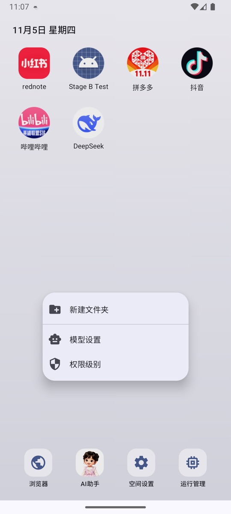
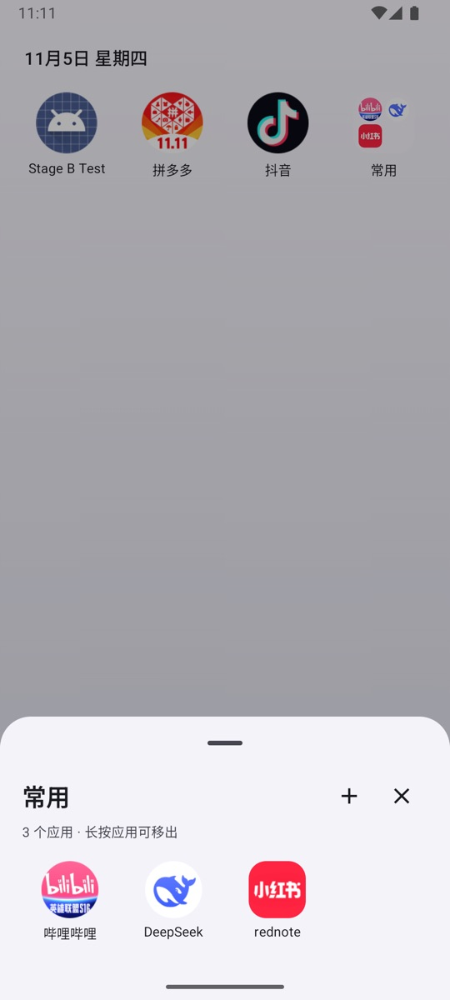

# 桌面与外观

NestSpace 的桌面不是系统桌面，而是应用内的启动器。它会显示底部固定入口、导入到虚拟空间的应用和你创建的文件夹。

## 桌面上的内容

底部固定入口：

| 入口 | 用途 |
| --- | --- |
| 浏览器 | 打开内置多标签浏览器 |
| AI助手 | 打开本地 AI 助手 |
| 空间设置 | 应用、模型、权限、悬浮球、MCP 等配置 |
| 运行管理 | 查看和结束正在运行的容器进程 |

之后会出现：

- 通过「应用管理 → 导入应用」从宿主安装到虚拟空间的应用。
- 通过「应用管理 → 导入 APK」安装的应用。
- 你自己创建的文件夹。

## 图标操作

### 点击

- 虚拟应用：启动最近使用的实例。
- 文件夹：打开文件夹。

### 长按应用

长按应用图标会打开菜单：

- **应用快捷方式**：应用自己提供的动态快捷方式（如果有）显示在菜单顶部。
- **打开**：启动应用。
- **添加到文件夹**：桌面已有文件夹时显示，选择要加入的文件夹。
- **移到最前 / 移到最后**：调整排序。
- **应用信息**：查看应用的包名、版本和实例信息。
- **卸载应用**：删除应用及所有实例数据。

### 长按空白处

长按桌面空白区域会打开快捷菜单：

- **新建文件夹**；
- **模型设置**；
- **权限级别**。

### 拖动

- 长按并拖动图标：调整位置，其他图标会预览让位。
- 拖到另一个应用上，重叠面积小于 30%：目标图标上显示文件夹虚影，松手后创建文件夹。
- 继续重叠到 30% 及以上（包括完全覆盖）：改为插入/移位。
- 拖到已有文件夹上：加入该文件夹。
- 文件夹内不能直接拖动排序；打开文件夹后，可以长按应用选择「移出文件夹」，也可以向上拖动移出。

桌面布局会自动保存，重启后保持。

## 文件夹

文件夹是桌面上的一个容器，可以：

- 打开并查看里面的应用；
- 点标题右侧的 **+** 添加应用；
- 长按文件夹选择重命名或解散；
- 打开后长按应用选择打开或移出，也可以向上拖动移出。

只剩一个应用的文件夹会自动解散；从空白处新建的空文件夹会保留，添加第一个应用后也会暂时保留，方便继续添加。

文件夹里保存的是桌面布局，不会移动或复制应用数据。

## 外观与壁纸

入口：**空间设置 → 外观**。

- 可以选择一张图片作为桌面壁纸。
- 可以清除壁纸，恢复默认背景。
- 可以设置容器顶部提示。
- 壁纸保存在应用私有目录，卸载 NestSpace 时一并删除。

## 导入宿主应用后的桌面图标

入口：**空间设置 → 应用管理 → 导入应用**。

- 勾选宿主应用后，NestSpace 会把对应 APK 安装到虚拟空间。
- 桌面图标启动的是虚拟空间中的独立副本，不是宿主原应用。
- 宿主应用的登录状态和私有数据不会复制到虚拟应用。
- 同名应用已经存在时，会显示将覆盖现有版本。

## 运行管理

入口：桌面「运行管理」。

页面显示：

- 当前正在运行的容器进程数量。
- 这些进程合计占用的内存。
- 按应用和实例分组的进程列表。

展开某一组可以：

- 查看每个容器进程的槽位、进程名和内存占用。
- 点右侧的关闭按钮结束单个进程；应用数据会保留。
- 点组右侧的关闭按钮结束该应用的全部容器进程。

被结束的应用下次启动时会重新创建进程并加载原来的数据。

## 桌面显示异常

- **图标消失**：检查「空间设置 → 应用管理」里应用是否还在，并直接从应用列表启动；桌面布局保存在应用内，清除 NestSpace 数据会重置布局。
- **排序混乱**：重新长按拖动即可，布局会自动保存。
- **导入宿主应用后没有图标**：确认安装已经完成；如果安装失败，查看应用管理页面的错误提示。
- **壁纸不显示**：重新进入「空间设置 → 外观」设置一次；如果图片已被删除，重新选择一张。

## 相关文档

- [应用安装与管理](app-manager.md)
- [设置详解](settings.md)
