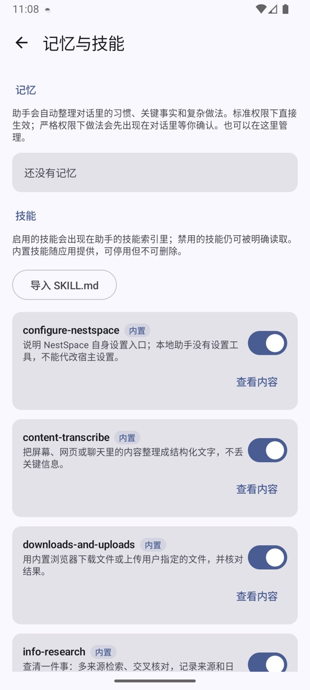
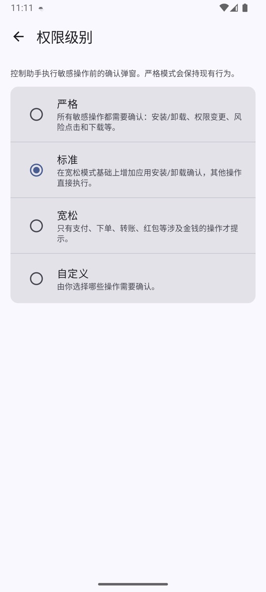

# 设置详解

桌面「空间设置」里的每个入口都在这里说明。部分页面有更详细的单独文档，会在对应小节里链接。

## 应用与容器

### 应用管理

安装 APK、导入桌面应用、管理虚拟应用和实例。详见 [应用安装与管理](app-manager.md)。

### 宿主控制（Root）

需要设备已 root，并允许 NestSpace 使用 su。

- 开启后，AI 助手和 MCP 会获得 `host_*` 工具，可以观察、点击、输入、截图、启动应用和打开网址；操作范围是整台真实设备，而不只是虚拟空间。
- 关闭后，这些工具会立即从助手和 MCP 的工具列表中移除。
- 每次开启都会重新检测 su；Root 不可用时开关无法打开。
- 权限很高，请只在可信设备上使用。

相关工具见 [MCP 工具参考](mcp-tools.md)。

### 容器槽位

容器进程池最多有 16 个槽位，每个槽位对应一个独立的容器进程。

- **自动**（默认）：按内存动态管理，最高可以使用全部 16 个槽位。内存紧张时优先关闭最久未使用的后台容器，前台容器不会被关闭。
- **固定档位**：限制同时运行的容器进程数（1–16）。降低上限会立即结束超出范围的进程。

修改后立即生效。应用数据不会因为结束进程而丢失。

### 容器自检

运行一组自动检查，确认容器基础能力是否正常：

- 启动虚拟应用；
- 读取界面和截图；
- 独立进程；
- WebView；
- MCP 服务。

每项结果分为通过、部分通过、失败和跳过，可以复制完整报告。排查兼容性问题或反馈 issue 时，附上自检报告很有帮助。

### 浏览器代理

为内置浏览器配置 HTTP 或 SOCKS 代理：

- 所有标签页和浏览器下载共用同一代理。
- 支持逗号分隔的绕过规则。
- 需要 Android 10+ 且 WebView 支持 `PROXY_OVERRIDE`。
- 暂不支持需要用户名/密码的代理。

详细说明见 [内置浏览器](browser.md)。

## 助手

### 模型设置

配置 AI 助手使用的模型接口，支持 Claude 兼容和 OpenAI 兼容两种协议。可以保存多个配置并切换，每个配置包含：

- 协议；
- Base URL；
- API Key；
- 模型名称；
- 上下文 token 上限；
- 单轮最大工具调用次数。

API Key 使用 Android Keystore 加密保存，任何工具结果都不会返回明文。点「测试连接」会发起一次真实请求。

详见 [AI 助手](assistant.md)。

### 系统提示词

所有模型共用一份系统提示词。可以编辑、保存，也可以一键恢复内置默认值。运行时 NestSpace 还会自动追加当前时间、记忆、技能索引和工具规则。

### MCP 工具

配置**外部** MCP Server，让本地 AI 助手使用更多工具：

- 支持多个 Streamable HTTP 端点；
- 使用 Bearer Token 鉴权；
- Token 使用 Android Keystore 加密保存；
- 刷新后请求 `initialize` / `tools/list`；
- 工具名以 `mcp_<服务短 ID>_` 前缀提供给本地助手。

外部工具不会暴露给远程 MCP 客户端，远程客户端也不能直接调用它们。详见 [MCP 控制服务](mcp.md)。

### 记忆与技能

- **记忆**：助手会在每轮对话后自动整理事实、偏好和做法。事实和偏好直接生效；做法在标准/宽松权限下直接生效，严格模式或自定义启用「风险点击」确认时先显示确认卡片。可以置顶、批准或删除。
- **技能**：随应用内置 7 个。助手会从成功的多步骤任务中自动起草技能；新技能始终默认停用，并在对话里显示启用卡片。每次使用会记录成功/失败；最近 3 次中失败 2 次会自动停用，手动重新启用后重新计数。
- 自定义技能可以编辑、导入 `SKILL.md`、查看版本历史并恢复旧版本；内置技能只能停用，不能删除或覆盖。

记忆和技能保存在应用私有目录，并使用加密存储。需要时，相关条目会随系统提示词发送给当前配置的模型服务，不会上传到其他服务器。密码、验证码、银行卡和身份证信息不会被自动记录。

### 定时任务

让助手创建定时任务，例如「每天早上 9 点看看天气，下雨才告诉我」。支持：

- 单次；
- 每天；
- 每周；
- 固定间隔。

任务到点后会在原对话里执行，并发送结果通知。任务由系统闹钟调度；如果 NestSpace 被系统彻底停止，任务会在下次启动后恢复调度。

### 评测与回放

用真实任务测试 Agent，记录每次运行的工具轨迹和结果；成功后可以把流程保存为回放，之后重复执行。

### 子任务记录

查看 `spawn_agent` 创建的子 Agent：

- 状态和结果；
- 停止正在运行的子任务；
- 结果按不可信数据处理，只用于给主 Agent 提供参考。

### Token 统计

按请求查看模型输入的 token、输出的 token 和思考 token，用于估算用量和成本。

### 权限级别

控制助手执行敏感操作前是否需要确认：

| 级别 | 行为 |
| --- | --- |
| 严格 | 安装/卸载、权限变更、风险点击、下载等都需要确认；可复用的做法也会先请求确认 |
| 标准 | 在宽松基础上增加应用安装/卸载确认；记忆和自动起草的技能直接保存（技能默认停用） |
| 宽松 | 只有支付、下单、转账、红包等涉及金钱的操作才提示 |
| 自定义 | 自己选择哪些类别需要确认 |

可以确认的类别包括安装、权限、下载、风险点击等。记忆和技能学习不算敏感操作；只有严格模式，或自定义模式启用了「风险点击」确认时，可复用的做法才会先请求确认。自动起草的技能始终默认停用，需要在对话卡片或记忆与技能页面手动启用。远程 MCP 客户端不受这个设置影响；远程工具调用由客户端自己控制。

### 悬浮球

- 打开或关闭悬浮球；
- 设置宿主界面和容器内的颜色；
- 调整透明度；
- 选择语音语言；
- 调整位置；
- 下载或删除离线语音模型。

首次启用需要授予「显示在其他应用上层」权限。悬浮球是语音助手的快捷入口，详见 [AI 助手](assistant.md)。

### MCP 控制服务

启动/停止对外的 MCP Server，查看本机和局域网地址、Token，以及后台启动所需的悬浮窗权限状态。

详见 [MCP 控制服务](mcp.md)。

## 桌面与语言

### 桌面壁纸

选择、更换或清除桌面壁纸。壁纸保存在应用内部，卸载 NestSpace 时一并清除。

### 语言

- **跟随系统**；
- **中文**；
- **English**。

修改后界面立即刷新。

## 关于

显示当前版本号和项目信息。

## 相关文档

- [快速开始](getting-started.md)
- [应用安装与管理](app-manager.md)
- [AI 助手](assistant.md)
- [MCP 控制服务](mcp.md)
- [常见问题](troubleshooting.md)
